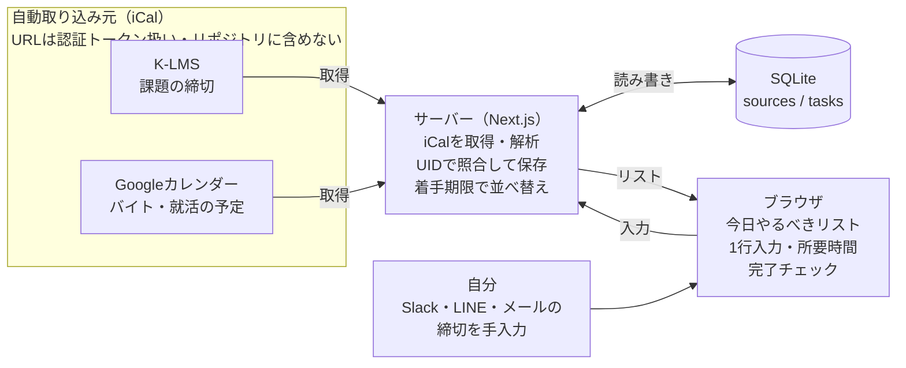

# 締切を1か所に集め、「今日やるべき順」に並べるWebアプリ 設計書

最終更新: 2026-11-23

## 概要

テーマ自由でアプリを1つ作り、公開GitHubリポジトリのURLを約2週間で提出する。評価は見た目や機能数ではなく「なぜこれを作ったのか」を自分の言葉で語れるかで決まる。

| 項目 | 課題PDFの指定 |
| --- | --- |
| 作るもの | アプリ1つ（Web・スマホ・業務ツール等、形式・規模・技術は自由。生成AI利用可） |
| 提出物 | GitHubリポジトリURL（Public）。APIキー・パスワード等の秘密情報は含めない |
| 期限 | 目安2週間後 |
| 面接で話すこと | 解決したい課題（誰の・どんな困りごと・選んだ理由）／アプリのデモ／工夫したポイント（こだわり・迷って決めたこと・あえてやらなかったこと） |
| 評価軸 | 問いを立てる力／論理的思考力（AIに頼りすぎず自分で考えているか）／判断を言葉にする力 |

この設計書は面接の3点にそのまま対応させる。課題設定と判断の理由は本人の言葉で書く。

## 解決したい課題

| 問い | 回答 |
| --- | --- |
| 誰が困っているか（具体的な1人を思い浮かべる） |  |
| どんな場面で、何に困っているか |  |
| 今はどうやってしのいでいるか（既存の代替手段） |  |
| その方法の何が不十分か |  |
| なぜこの課題を選んだか（自分との接点・他候補を捨てた理由） |  |
| 解決できたと言える状態（成功の基準） |  |

## 解決策とシステム構成

LMSとGoogleカレンダーのiCalフィードを自動で取り込み、Slack・LINE・メール由来の締切は1行で手入力する。各締切に所要時間を付け、「着手すべき日」が早い順に今日のリストを出す。

| 区分 | 内容 | 理由 |
| --- | --- | --- |
| やること | iCalフィードの登録と取り込み（K-LMS、Googleカレンダー） | 自分の締切の大半がここにあり、公式の取得手段がある |
| やること | 1行での手入力（例：「ゼミ発表資料 12/5」） | LINE等、自動化できない経路が残るため必須 |
| やること | 所要時間のワンタップ入力（30分／2時間／半日／1日／2日／3日／1週間） | 取り込めるのは日付だけで、並べ替えに所要時間が要る |
| やること | 「今日やるべき順」のリストと完了チェック | アプリの中心。これがないとただのカレンダー |
| あえてやらない | メール・Slackの自動抽出 | OAuth・文面解析のコストが大きく、LINEはそもそも不可。手入力の速さに集中する |
| あえてやらない | 通知・定期の自動同期 | 開いたときに同期すれば足りる。必要性は使ってみて判断 |
| あえてやらない | 複数ユーザー・ログイン | まず自分一人の課題を解く |
| 形式 | Webアプリ（PC・スマホのブラウザ） | インストール不要でデモしやすい |
| 技術スタック | Next.js（App Router、サーバー兼画面）＋ SQLite ＋ Drizzle ORM | iCalはブラウザから直接取得できない（CORS）ためサーバー側が必要。SQLiteはファイル1つで動き、一人用のデータ量に十分。DrizzleはスキーマをTypeScriptで書け、SQLに近く中身を説明しやすい |
| 秘密情報 | iCal URLはリポジトリに含めない | URL自体が認証トークン。知られると課題一覧が読める |

### 構成



iCalはサーバーが画面を開いたときに取得し、手入力分と合わせて着手期限順に並べてブラウザに返す。

### ディレクトリ構成

```
.
├── README.md                  # 設計書（このファイル）
├── .env.example               # 必要な環境変数の見本（DBの保存場所など。iCal URLは書かない）
├── .gitignore                 # .env と data/*.db を除外
├── package.json
├── drizzle.config.ts
├── drizzle/                   # マイグレーションSQL（npm run db:generate で生成。起動時に自動で適用）
├── data/
│   └── .gitkeep               # SQLiteファイルの置き場所（中身はgit管理外）
├── src/
│   ├── app/
│   │   ├── layout.tsx
│   │   ├── page.tsx           # 今日やるべきリスト（開いたときに同期）
│   │   ├── actions.ts         # 手入力・所要時間・完了・取り消し確認の書き込み
│   │   ├── calendar/
│   │   │   └── page.tsx       # 着手すべき日のタイムライン（?weeks=2|4|8）
│   │   └── sources/
│   │       ├── page.tsx       # iCalフィードの登録・削除
│   │       └── actions.ts
│   ├── components/
│   │   ├── TaskList.tsx       # 「今日やる」「見積もりを入れて」「取り消された？」の各欄
│   │   ├── QuickAdd.tsx       # 1行入力（入力中に件名・締切をプレビュー）
│   │   ├── EstimatePicker.tsx # 所要時間7択
│   │   ├── PendingButton.tsx  # 送信中は押せなくするボタン
│   │   ├── AddSourceForm.tsx  # フィードの登録（登録と同時に取り込む）
│   │   ├── SourceList.tsx     # 登録済みフィード（URLはホスト名だけ表示）
│   │   ├── TaskTimeline.tsx   # タイムライン（帯 = 着手すべき日〜締切の前日、◆ = 締切）
│   │   ├── SiteNav.tsx        # リスト／カレンダー／フィードの切り替え
│   │   └── layout.ts          # トップページの2列の列幅
│   ├── db/
│   │   ├── schema.ts          # sources / tasks（Drizzle）
│   │   ├── client.ts          # 接続と起動時のマイグレーション
│   │   ├── queries.ts         # 画面表示用の読み出し
│   │   ├── mutations.ts       # 締切の書き込み（状態の遷移を制限）
│   │   ├── sources.ts         # フィードの登録・削除（取り込めないURLは登録しない）
│   │   └── syncSources.ts     # 同期の計画をDBに反映（自動同期は5分に1回まで）
│   └── lib/                   # アプリの中心ロジック（画面やDBに依存しない）
│       ├── date.ts            # 日本時間への変換・日付計算
│       ├── format.ts          # 画面表示用の書式（12/5(土)、あと3日 など）
│       ├── urgency.ts         # 急ぎ具合（締切超過・今日明日・着手の遅れ）
│       ├── timeline.ts        # タイムラインの配置計算
│       ├── priority.ts        # 着手期限の計算と並べ替え
│       ├── parseQuickAdd.ts   # 「ゼミ発表資料 12/5」→ 件名＋締切
│       └── sync.ts            # iCal取得・UID照合・取り消し検出
└── tests/
    ├── date.test.ts
    ├── priority.test.ts
    ├── parseQuickAdd.test.ts
    ├── sync.test.ts
    ├── format.test.ts
    ├── urgency.test.ts
    ├── timeline.test.ts
    ├── db.test.ts             # メモリ上のSQLiteで制約と同期を確かめる
    └── sources.test.ts
```

- 中心ロジックは `src/lib/` に画面・DBから切り離した関数として置き、並べ方の規則をテストで確かめる
- 書き込みはAPI Routesではなく Server Actions で行う。自分しか使わないため外部向けAPIは不要
- iCal URLは画面から登録してDBに保存し、DBファイルごと `.gitignore` で除外する
- iCalの日時はUTCで届くことが多いため、「今日」「締切日」の判定は日本時間（Asia/Tokyo）に直してから行う

### 並べ方のロジック

1日に使える作業時間を8時間とみなし、所要時間を日数に直して締切から引いた「着手期限」が早い順に並べる。着手期限が今日以前のものを「今日やる」として上に出す。

```
必要日数 = ⌈所要時間（時間）÷ 8⌉
着手期限 = 締切日 − 必要日数
```

| 所要時間の選択肢 | 時間換算 | 必要日数 | 締切 12/5 の場合の着手期限 |
| --- | --- | --- | --- |
| 30分 | 0.5時間 | 1日 | 12/4 |
| 2時間 | 2時間 | 1日 | 12/4 |
| 半日 | 4時間 | 1日 | 12/4 |
| 1日 | 8時間 | 1日 | 12/4 |
| 2日 | 16時間 | 2日 | 12/3 |
| 3日 | 24時間 | 3日 | 12/2 |
| 1週間 | 56時間 | 7日 | 11/28 |

- 締切日当日は作業日に数えない（締切が朝や授業前のことが多いため）
- 授業やバイトの有無による日ごとの差は考慮しない（1日一律8時間）
- 所要時間が未入力の締切は「見積もりを入れて」欄に分け、順位を付けない
- 着手期限が同じものは締切が早い順、それも同じなら所要時間が長い順

### データ設計

| テーブル | 主な項目 | 役割 |
| --- | --- | --- |
| sources | id, 名前, iCal URL, 最終同期日時, 最後の同期エラー | 取り込み元のフィード（K-LMS、Googleカレンダー） |
| tasks | id, source_id（手入力なら空）, external_uid, 件名, 締切, 所要時間（分）, 状態（未着手／完了／取り消し確認／削除済み）, 残す（取り消し確認で「残す」を選んだか） | 締切そのもの |

- 再同期では iCal の UID（external_uid）で既存の締切と照合し、件名と締切だけ更新する。自分で入れた所要時間と完了状態は上書きしない
- フィードから消えた締切は自動では消さず、状態を「取り消し確認」にしてリスト上で「取り消された？」と表示する。自分で「削除」か「残す」を選ぶ
- 「残す」を選んだ締切は、以後フィードになくても「取り消し確認」に戻さない。フィードとのつながり（external_uid）は保つので、後でフィードに戻ってきても二重に取り込まず、件名・締切の変更は反映する
- 不要な締切（授業の予定やGoogleカレンダーの「Busy」など）は「削除」できる。手入力はDBから消し、フィード由来は「削除済み」にしてリストに出さない。フィード由来をDBから消すと次の同期でまた取り込まれるため、DBには残してUIDで見分ける。押し間違いに備えて「削除したもの」から戻せる
- 繰り返し予定は、これから来る直近の1回だけ取り込む。回ごとに「UID#その回の本来の開始日時」で区別し、その回が過ぎたら次の同期で次の回が出る。どれか1回を「削除」したら、その繰り返し予定の以後の回も取り込まない（毎週のバイトなど締切でない予定を一度で消せる）
- フィードを削除すると、そのフィード由来の締切も一緒に消える（手入力の締切は残る）
- 同期に失敗したフィードは「最後の同期エラー」に理由を記録し、他のフィードの同期や画面表示は止めない。エラー文にiCal URLは含めない
- 日時はUNIXミリ秒の整数で保存し、日本時間への変換はアプリ側（`src/lib/date.ts`）で行う
- 「source_idとexternal_uidは両方あるか両方空」「所要時間は正の数」「同じフィードに同じUIDは1件」をDBの制約で守る
- ただし締切が過去の締切はフィードから自然に消えることがあるため、締切が未来のものだけを「取り消し確認」の対象にする（K-LMSのフィードには約4週間前までの課題が含まれ、それより古いものは消えていくことを確認済み）
- K-LMSのフィードでは、課題の締切はUTC（例: 07:00Z = 日本時間16:00）、授業の予定などは終日（`DTSTART;VALUE=DATE;VALUE=DATE:` と二重に書かれる）で届く

## 判断ログ

迷ったことはその場でここに記録する。面接の「工夫したポイント（迷った末に決めたこと・あえてやらなかったこと）」はこの表から話せる。

| 日付 | 論点 | 検討した選択肢 | 決めたこと | 理由 |
| --- | --- | --- | --- | --- |
| 2026-11-23 | 不要なフィード由来の締切の消し方 | DBから消す／「削除済み」にして残す | 「削除済み」にして残し、戻せるようにする | （自分の言葉で）。DBから消すと次の同期でまた取り込まれるため |
| 2026-11-23 | フィードを削除したときの締切 | 一緒に消す／手入力扱いにして残す | 一緒に消す | （自分の言葉で） |
| 2026-11-23 | 繰り返し予定の扱い（見直し） | 取り込まない／先の数週分をすべて取り込む／直近の1回だけ取り込む | 直近の1回だけ取り込む | （自分の言葉で）。最初は「取り込まない」にしたが、毎週の締切（GM資料）を繰り返し予定で入れたら取り込まれず、締切も繰り返し予定で入れることがあると分かった |
| 2026-11-23 | 繰り返し予定の扱い | 先90日分を展開して取り込む／取り込まない | 取り込まない | （自分の言葉で） |
| 2026-11-23 | 「残す」を選んだ締切の次回同期 | 毎回確認し直す／フィードとのつながりを外して手入力扱いにする／「残す」の印を付けて以後確認しない | 「残す」の印を付けて以後確認しない | （自分の言葉で）。つながりを外す案は、フィードに戻ってきたとき二重に取り込まれるため採らなかった |
| 2026-11-23 | DBの操作方法 | Drizzle ORM／Prisma／better-sqlite3で生SQL | Drizzle ORM | （自分の言葉で） |
| 2026-11-23 | 所要時間の選択肢 | 30分〜1日の4択／2日・3日・1週間を追加 | 2日・3日・1週間を追加して7択 | 1日8時間換算だと4択はすべて必要日数1日になり、着手期限に差が出ないため |
| 2026-11-23 | LMSで消えた課題 | 自動で削除／確認表示 | 「取り消された？」と確認表示し、自分で削除か残すかを選ぶ | （自分の言葉で） |
| 2026-11-23 | 1日の作業時間 | 考慮しない／一律で数える／日ごとに設定 | 1日一律8時間として所要時間を日数に換算 | （自分の言葉で） |
| 2026-11-23 | 技術スタック | （他に検討した候補を自分で） | サーバーはNext.js、データベースはSQLite | （自分の言葉で） |
| 2026-11-23 | 自動連携の範囲 | 全経路を自動化／iCalだけ自動化し残りは手入力 | K-LMSとGoogleカレンダーはiCalで自動、Slack・LINE・メールは1行手入力 | LINEは自動化できず手入力は結局必要。2週間をiCalと手入力の速さに集中。K-LMSにカレンダーフィードがあることを確認済み |
| 2026-11-23 | 並べ方 | 締切が近い順／締切と所要時間から逆算／締切×重要度スコア | 締切と所要時間から逆算した「着手すべき日」順 | （自分の言葉で） |
| 2026-11-23 | 入力方法 | 手入力を速く／テキスト貼り付けでAI抽出／LMS等と自動連携 | LMS等と自動連携 | （自分の言葉で） |
| 2026-11-23 | 集める対象 | LMS／Slack・LINE・メール／口頭連絡／バイト・就活 | LMS、Slack・LINE・メール、バイト・就活 | 自分の締切が実際に届く場所 |
| 2026-11-23 | テーマ | 締切の一元管理／扶養控除の年収見込み／立替精算／就活選考管理／食材の使い切り／発表の想定質問 | 締切を1か所に集め、「今日やるべき順」に並べるWebアプリ | （自分の言葉で：実際に締切を見落とした場面など） |

## 未決事項

- [ ] 課題の受領日と提出日（「2週間後」の起点）
- [ ] 「解決したい課題」の表を埋める
- [x] 技術スタックを決める → Next.js ＋ SQLite
- [x] 1日に使える作業時間を考慮するか → 1日一律8時間
- [x] LMSで取り消された課題の扱い → 確認表示
- [x] K-LMSのフィードに過去の課題がどこまで含まれるか確認する → 約4週間前まで含まれる（2026-11-23時点で最も古いものは10/26、21件中7件が過去）。過去の締切は取り込まない・取り消し確認の対象にしない、という規則で問題ない
- [ ] 提出前確認：リポジトリPublic、秘密情報なし、READMEに課題・起動手順・デモ方法
